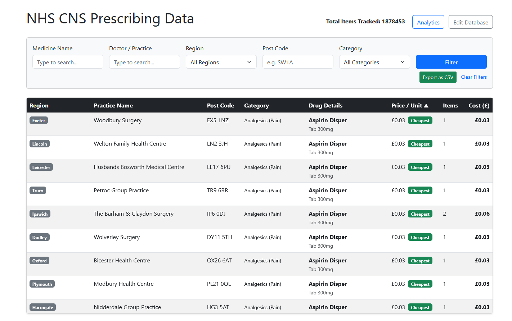
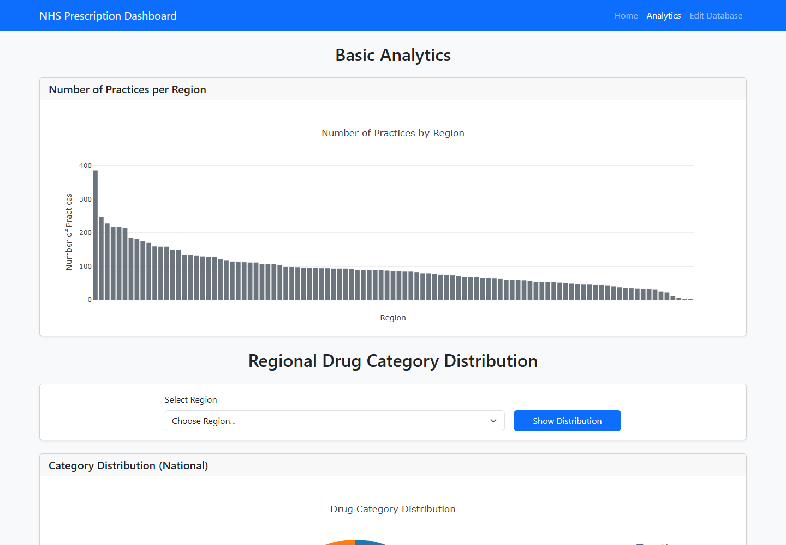
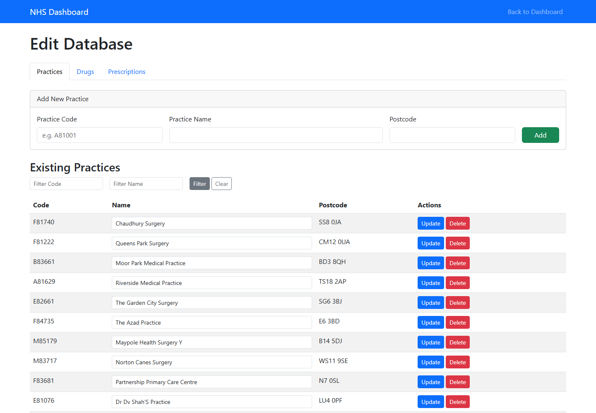

# NHS CNS Prescribing Data Dashboard

A Flask web app for exploring what GP practices in England spent on central nervous system (CNS) medicines in December 2019. You can filter and sort individual prescriptions, compare costs across regions and drug categories, export the results, and edit the underlying database.



## Problem

NHS Digital publishes practice-level prescribing data every month, but each release is one flat CSV of roughly 9 million rows and 776 MB. It covers every drug and every practice, and practices appear only as codes. Simple questions are hard to answer from it directly:

- Which practices pay the most, or the least, per unit for a given medicine?
- How does the average cost per item differ between regions?
- Which CNS drug categories (antidepressants, analgesics, antiepileptics and so on) account for the most spend?

This project narrows the release to BNF Chapter 4 (Central Nervous System), joins it to practice names and locations, and serves the result through a searchable dashboard with charts.

## Data

| | |
|---|---|
| **Source** | [NHS Digital: Practice Level Prescribing Data, December 2019](https://digital.nhs.uk/data-and-information/publications/statistical/practice-level-prescribing-data/december-2019) |
| **Prescribing file** (`raw_pdpi.csv`) | 9,353,682 rows, one per practice × BNF presentation. Columns: SHA, PCT, PRACTICE, BNF CODE, BNF NAME, ITEMS, NIC, ACT COST, QUANTITY, PERIOD |
| **Practice address file** (`raw_address.csv`) | 9,324 practices with name, address and postcode (no header row) |
| **Licence** | [Open Government Licence v3.0](https://www.nationalarchives.gov.uk/doc/open-government-licence/version/3/) |

The data files are not stored in this repository because of their size. The processed CSVs are attached to the [GitHub release](https://github.com/RoshanBM/PAI_Individual_1/releases), and [How to run](#how-to-run) explains how to use them or rebuild them from the raw NHS files.

## Method

**1. Preprocessing** (`nhs_pai/scripts/preprocess_data.py`)

- The 776 MB prescribing file is read in 100,000-row chunks, so it never has to fit in memory all at once.
- Only rows whose BNF code starts with `04` (Chapter 4, Central Nervous System) are kept.
- Each row gets a category from its 4-digit BNF section (`0401` Hypnotics & Anxiolytics through `0411` Dementia, 11 categories).
- `BNF NAME` is split at the first `_` into a drug name and a presentation (for example `Sertraline HCl` / `Tab 50mg`), giving a lookup table of unique drugs.
- Practice names are converted to title case and postcodes are normalised. Each practice is mapped to a region using its postcode area (the leading letters, e.g. `CV` → Coventry).
- The script writes three files: `clean_prescriptions.csv`, `clean_drugs.csv` and `clean_practices.csv`.

**2. Storage** (`nhs_pai/src/database_manager.py`)

The cleaned CSVs are loaded into a normalised SQLite database with three tables: `practices`, `drugs`, and `prescriptions` (which has foreign keys to the other two). The app builds the database automatically the first time it starts.

**3. Web app** (`nhs_pai/src/app.py`, Flask + Bootstrap 5 + Plotly.js)

- **Dashboard:** joins the three tables and calculates price per unit (`ACT COST / QUANTITY`). You can filter by medicine, practice, region, postcode and category, and sort by price per unit, items or cost. The cheapest and most expensive rows are flagged, and the current view can be exported to CSV.
- **Analytics:** bar chart of practices per region; regional comparisons of average cost per item (by category) or price per unit (by drug); pie charts of category share, nationally or for one region.
- **Edit Database:** create, read, update and delete practices, drugs and prescriptions. Practice codes, BNF codes and postcodes are checked with regex validators before anything is written.
- **Logging:** page visits and data changes are written to `nhs_pai/logs/app.log`, a rotating log file.

**4. Testing**

The `nhs_pai/tests/` folder has 32 pytest tests covering preprocessing, validation, the analytics calculations, filtering, CSV export, the CRUD routes, chart generation, logging and edge cases.

## Results

All figures below were calculated from the processed December 2019 data in this repository.

**Scale**

| Metric | Value |
|---|---|
| Raw prescribing rows scanned | 9,353,682 |
| CNS (Chapter 4) rows kept | **1,878,453** (20.1%) |
| Unique CNS drug presentations | 2,383 |
| Practices (with ≥1 CNS prescription) | 9,324 (8,587) |
| Regions (postcode areas mapped) | 101 |
| Items dispensed | **18,012,979** |
| Actual cost | **£117.9 million** |
| Average cost per item | **£6.55** |

**Spend by CNS category**

| Category | Items | Actual cost | Share of cost | Cost / item |
|---|---:|---:|---:|---:|
| Analgesics (Pain) | 5,138,009 | £34.20m | 29.0% | £6.66 |
| Antiepileptics | 2,476,541 | £25.13m | 21.3% | £10.15 |
| Antidepressants | 6,398,213 | £18.85m | 16.0% | £2.95 |
| Psychosis & Related | 1,038,602 | £9.37m | 7.9% | £9.02 |
| Parkinsonism | 448,299 | £7.86m | 6.7% | £17.53 |
| Hypnotics & Anxiolytics | 1,200,920 | £5.96m | 5.1% | £4.96 |
| CNS Stimulants/ADHD | 132,468 | £4.99m | 4.2% | £37.67 |
| Substance Dependence | 300,777 | £4.99m | 4.2% | £16.58 |
| Nausea & Vertigo | 507,242 | £3.39m | 2.9% | £6.69 |
| Dementia | 346,408 | £2.48m | 2.1% | £7.15 |
| Obesity | 25,500 | £0.71m | 0.6% | £27.95 |

**Key findings**

- **Antidepressants are the highest-volume category but cheap per item.** They account for 35.5% of CNS items but only 16.0% of cost (£2.95 per item, against an average of £6.55). Analgesics and antiepileptics together make up half of all CNS spend.
- **ADHD stimulants are the most expensive category per item.** At £37.67 per item they cost about 13× as much as antidepressants, followed by obesity drugs at £27.95.
- **Most-prescribed drugs:** sertraline (1.46m items), paracetamol (1.44m), amitriptyline (1.19m) and citalopram (1.18m). Paracetamol (£4.73m) and co-codamol (£4.29m) have the highest total cost.
- **Cost per item varies by region.** Among regions with more than 100,000 items, it ranges from £4.60 in Sunderland, £4.62 in Durham and £4.97 in Newcastle to £7.76 in Kingston upon Thames, £8.22 in Redhill and £8.27 in Guildford. The North East pays about 44% less per item than parts of Surrey, though this may reflect differences in prescribing mix as well as price.
- **Price per unit for the same drug varies widely between practices.** The dashboard's "Cheapest" and "Highest" flags make these outliers easy to find for any medicine.

| Analytics | Database management |
|---|---|
|  |  |

## How to run

**Requirements:** Python 3.11+ and about 2 GB of free disk space for the data.

**1. Clone the repository and install dependencies**

```bash
git clone https://github.com/RoshanBM/PAI_Individual_1.git
cd PAI_Individual_1

python -m venv .venv
# Windows (PowerShell):  .\.venv\Scripts\Activate.ps1
# macOS / Linux:         source .venv/bin/activate
pip install -r requirements.txt
```

**2. Get the data** (choose one option)

*Option A: quick start (about 18 MB).* Download [`processed-data.zip`](https://github.com/RoshanBM/PAI_Individual_1/releases/download/v1.0/processed-data.zip) from the [latest release](https://github.com/RoshanBM/PAI_Individual_1/releases) and unzip it into `nhs_pai/data/processed/`, so that folder contains `clean_drugs.csv`, `clean_practices.csv` and `clean_prescriptions.csv`. Then skip to step 4.

*Option B: full pipeline (about 776 MB).* From the [NHS Digital December 2019 release page](https://digital.nhs.uk/data-and-information/publications/statistical/practice-level-prescribing-data/december-2019), download these two files, rename them, and put them in `nhs_pai/data/raw/`:

| Downloaded file | Save as |
|---|---|
| `T201912PDPI BNFT.csv` (practice prescribing data, about 776 MB) | `nhs_pai/data/raw/raw_pdpi.csv` |
| `T201912ADDR BNFT.csv` (practice addresses) | `nhs_pai/data/raw/raw_address.csv` |

**3. Build the processed data** (Option B only)

```bash
cd nhs_pai
python scripts/preprocess_data.py
```

This scans all 9.35 million rows in chunks and writes three CSVs to `nhs_pai/data/processed/`. It takes a few minutes.

**4. Start the app**

```bash
cd src          # i.e. nhs_pai/src
python app.py
```

Then open <http://127.0.0.1:5000/>.

On the first start the app builds `nhs_pai/data/nhs_data.db` from the processed CSVs. This takes a minute or two (about 1.9 million rows); later starts are immediate.

**Run the tests** from the repository root. Get the data first (step 2), because most tests use the real data:

```bash
python -m pytest nhs_pai/tests/
```

## Project structure

```
PAI_Individual_1/
├── nhs_pai/
│   ├── data/
│   │   ├── raw/                # NHS source CSVs (download; not committed)
│   │   └── processed/          # Cleaned CSVs built by the script (not committed)
│   ├── scripts/
│   │   └── preprocess_data.py  # Chunked filter / clean / map pipeline
│   ├── src/
│   │   ├── app.py              # Flask routes, filtering, charts, export
│   │   ├── analytics.py        # Cost-per-item and price-per-unit stats
│   │   ├── database_manager.py # SQLite schema and CRUD
│   │   ├── utils.py            # Input validators
│   │   └── templates/          # Dashboard, analytics, edit pages
│   └── tests/                  # pytest suite (32 tests)
├── docs/screenshots/
├── requirements.txt
└── README.md
```

## Limitations

- **Regions are approximate.** They come from postcode areas, not official NHS geographies such as ICBs, so a large area like `B` (Birmingham) is treated as one region.
- **Cost per item ignores clinical mix.** Regional differences may reflect what is prescribed (drug and strength), not only the price paid.
- **The data covers one month.** December 2019 is a single snapshot, so seasonality and trends are not captured.
- **Not production-hardened.** The Flask secret key is hard-coded, the app runs in debug mode, and there is no authentication on the edit pages. It is intended for local use only.
